<div align="center">

# ✦ GenCouncil

[English](README.md) · [한국어](README.ko.md) · **日本語**

**AIチームがあなたの机の上の小さな書斎で働く、ローカルのマルチAIオーケストレーター**

議長AIが仕事を分けて Claude · GPT · Gemini · Grok の委員に同時に任せ、結果をレビューして一つにまとめます。アバターモードでは、その様子がそのまま見えます。議長は机に座り、委員たちは小さなキャラクターになって机の上で働き、話し、報告し、居眠りし、踊ります。

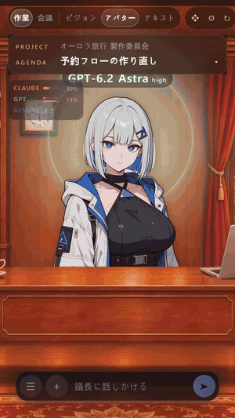

<sub>スマートフォンで見たアバターモード · 議長を GPT から Claude に替え、1行の指示を5つのモデルに振り分けたあと、議長が踊る場面 · 動画: <a href="docs/media/avatar/avatar-9x16-ja.mp4">スマートフォン(mp4、30秒)</a> · <a href="docs/media/avatar/avatar-16x9-ja.mp4">デスクトップ(mp4、30秒)</a></sub>

</div>

---

## GenCouncil とは

GenCouncil は自分のPCで動く**マルチAIオーケストレーター**です。AIコーディングツールは、それぞれ得意なことが違います。速くて安いモデル、丁寧なモデル、難しい設計を最後までやり遂げるモデルがあります。GenCouncil はそれらを**「製作委員会」**としてまとめ、誰が何をいつ担当するかを調整して、一つのプロジェクトで一緒に働かせます。

- **判断はAIが**: 議長モデルが仕事を分け、タスクごとに会社 · モデル · 推論レベルを選び、結果をレビューしてマージするかやり直させるかを決めます。
- **実行管理は GenCouncil が**: 委員プロセスの起動と停止、worktree での分離、ユーザーが決めた上限の順守、アカウントの上限に達したときの引き継ぎ、進捗と報告を議長に届けることはサーバーが担います。

すべてのAIは**すでに使っているサブスクリプションのログインのまま**、ヘッドレスCLIとして動きます(Claude Code、Codex CLI、Antigravity CLI、Grok)。APIキーの従量課金ではなくサブスクリプションの上限内で動き、上限に達したら別のアカウントや下位モデルで作業を続けます。

## 🎭 アバターモード

これからの GenCouncil の主役はアバターモードです。作業室と同じ委員会を、のぞき込める部屋として見せます。

<div align="center">
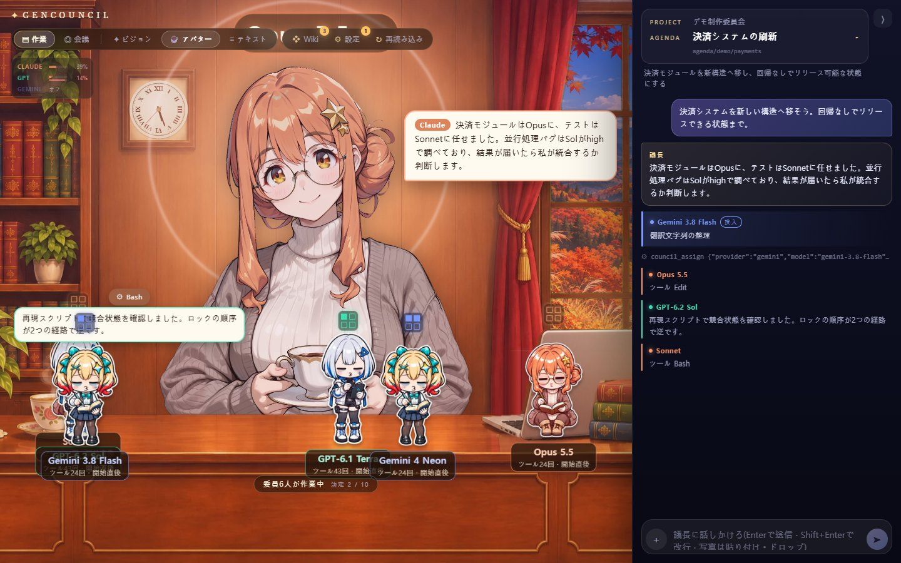
</div>

- **机に座る議長。** 議長は自分の会社のキャラクターで登場します(Claude · GPT · Gemini · Grok、ウェブリレーはドッツ)。議長のモデルを替えると、別のキャラクターが席に着きます。返答は吹き出しに出て、声が聞こえている間は口が動きます。
- **机の上の委員。** 議長が送り出した委員は、モデル名と進み具合を付けた小さなキャラクターとして机に降りてきます。開始 · 完了 · 失敗のたびに一言しゃべり、歩き回ったり座って作業したりして、終わると議長のところへ報告に行きます。
- **委員どうしのおしゃべり。** 作業の合間に、委員はときどき独り言を言ったり、短い会話をしたりします(韓国語 · 日本語 · 英語のセリフが数百)。
- **声。** 議長と委員のイベントのセリフは録音された声で流れます。希望すれば、録音のない言葉(議長の返答、おしゃべり)もTTSで読み上げます(録音とは別の声です)。
- **横に開いた記録。** ワイド画面では、議題の記録(指示 · 返答 · 委員の報告)が右側に開いたままです。スマートフォンでは入力欄と議長の最新の言葉が下にあります。

<table>
<tr>
<td width="50%">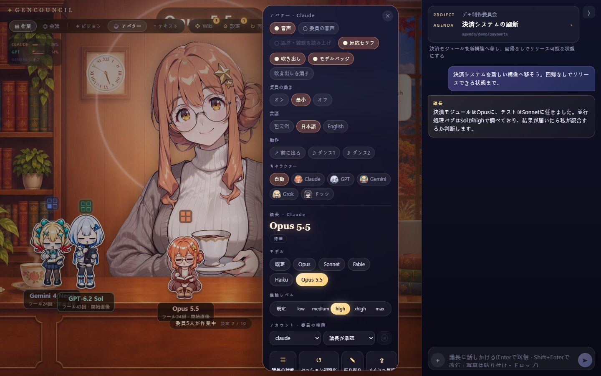</td>
<td width="50%">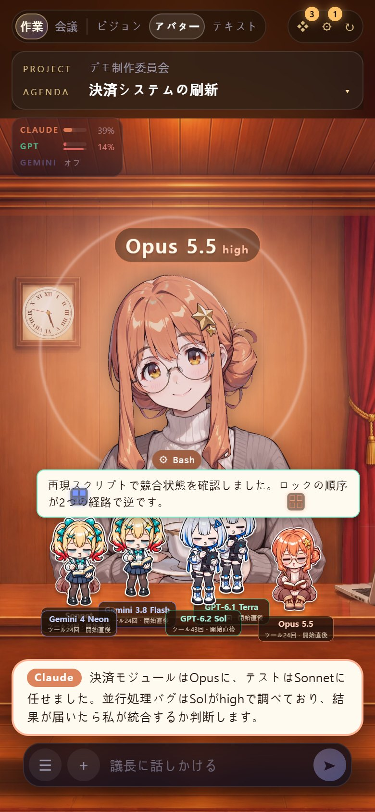</td>
</tr>
<tr>
<td><sub><b>議長メニュー</b>(右クリック、スマートフォンは長押し): 音声のオンとオフ、委員の音声、返答 · 雑談の読み上げ、反応セリフ、吹き出し、委員の動きの量、言語、キャラクターの固定、前に出ることとダンス。下には議長のモデル · 推論レベル · アカウントと議題の操作があります。</sub></td>
<td><sub><b>スマートフォン</b>: 狭い画面に合わせた同じ書斎です。入力欄から指示を出し、指で委員をつまみ上げられます。</sub></td>
</tr>
</table>

### お遊び機能

<table>
<tr>
<td width="50%">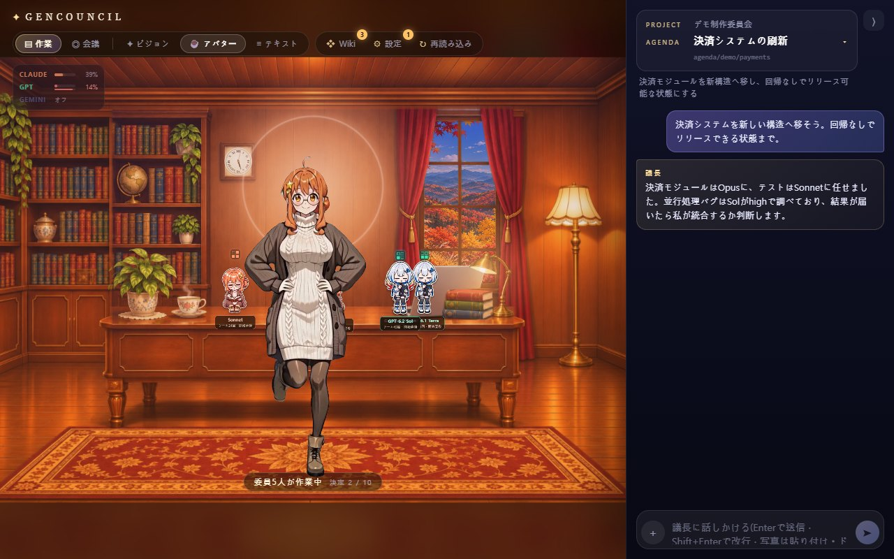</td>
<td width="50%">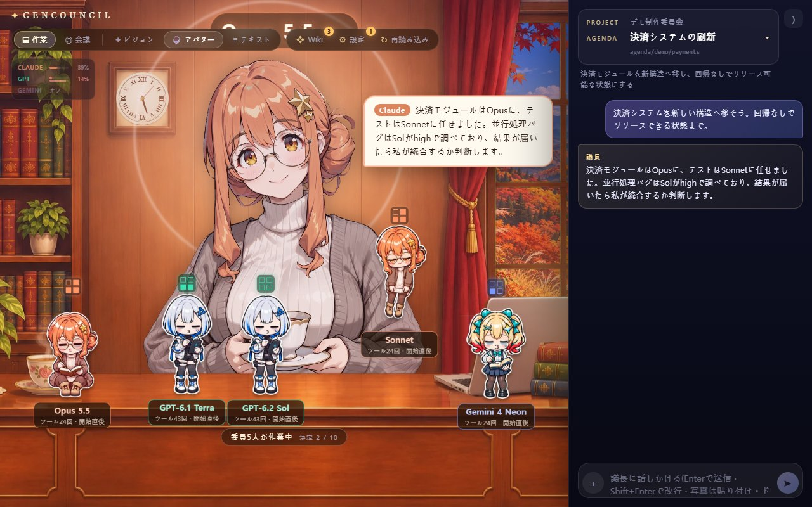</td>
</tr>
<tr>
<td><sub><b>前に出て踊る</b>: 全身の絵があるキャラクターは、席を立って机を回り込み、前に出て踊ります(キャラクターごとに2種類)。カメラが引いて頭からつま先まで映します。</sub></td>
<td><sub><b>委員をつまみ上げる</b>: 委員を押したまま(マウスか指で)持ち上げて運び、離すと机に落ちて、ぱっと起き上がります。</sub></td>
</tr>
</table>

- **議長をつつくと**、キャラクターらしい一言とともに頬を赤らめ、少し跳ねます。
- 委員は**転び、待っている間は居眠りし、終わると喜び、失敗するとしょんぼりします。**
- 書斎の窓の外は**季節と時刻**に合わせて変わります。

### 会議室

<div align="center">
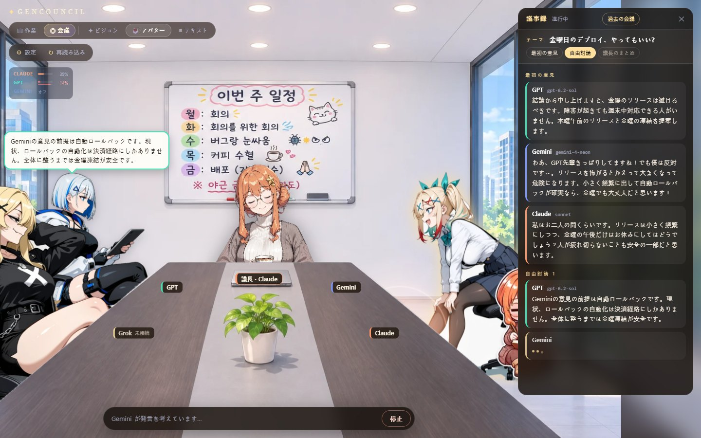
</div>

会議室でテーマを投げると、委員たちがテーブルを囲みます。それぞれ意見を出して議論し、議長が結論をまとめます。議事録は右側に残ります。作業室が仕事を片付ける場所なら、会議室は考えを出し合う場所です。

### フローティング議長(デスクトップアプリ)

<div align="center">
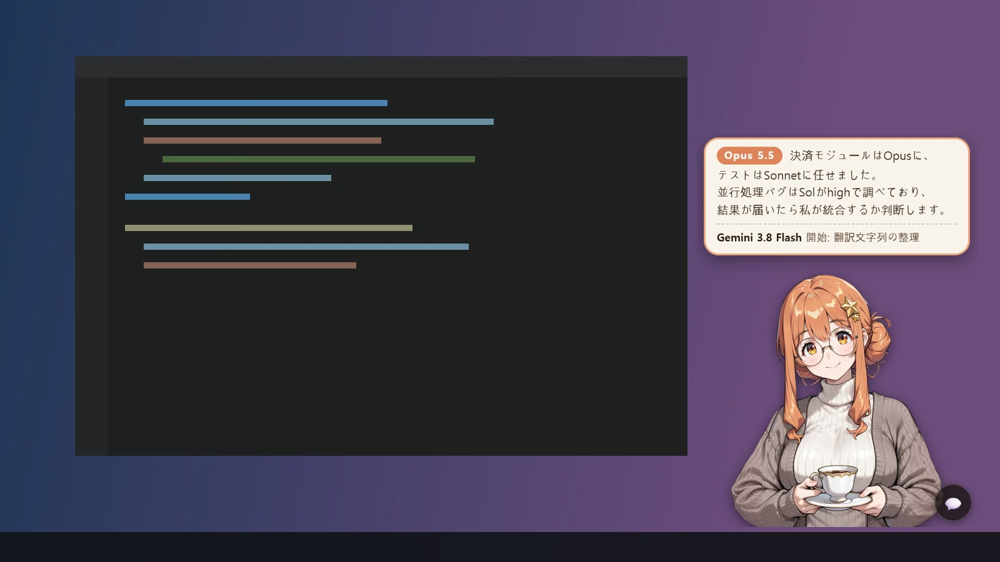
</div>

Windows デスクトップアプリ([apps/desktop](apps/desktop/README.md))でウィンドウを閉じてトレイに入れると、議長がデスクトップに残ります。右下の小さな透明ウィンドウで、常に手前に表示されますが、フォーカスは奪いません。吹き出しには議長の最新の返答、決定を待っている質問、最新の委員の報告が出て、💬を押すと入力欄が開いてすぐに指示できます。ドラッグで好きな場所に動かせ、ダブルクリックでメインウィンドウに戻ります。

### シングルモード

<div align="center">
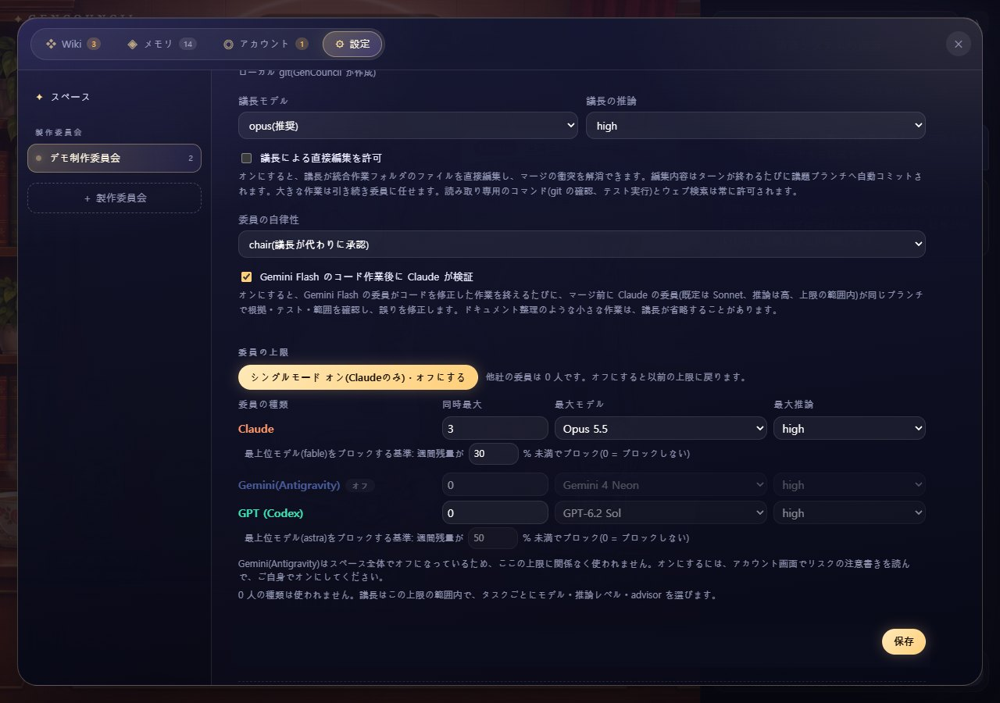
</div>

委員会全体を一つの会社だけで動かしたいときは、委員会設定のボタン一つで**議長と同じ会社**の委員だけを残し、ほかの会社はすべて0人にします。オフにすると以前の上限に戻ります。

### 3つの言語

コンソール全体とキャラクターのセリフ · 声を、**韓国語 · 英語 · 日本語**から選べます。テキスト作業室のテーマボタンの横、設定 › スペース › 画面、または議長メニューで切り替えます。サーバーのメッセージと、議長 · 委員が書いた内容はそのままです。

## ほかの表示

同じ委員会を3通りの見た目で表示できます。左上のスイッチで表示を切り替えても、部屋(作業室 · 会議室)はそのままです。

| | |
|---|---|
| **🎭 アバター** | 上の書斎です。 |
| **✦ ビジョン** | 議長を中央に、会社を頂点に置いた夜空の絵です。指示が線をたどって降り、ダイヤルがモデルを選び、委員が枝のように伸びて働きます。 <br>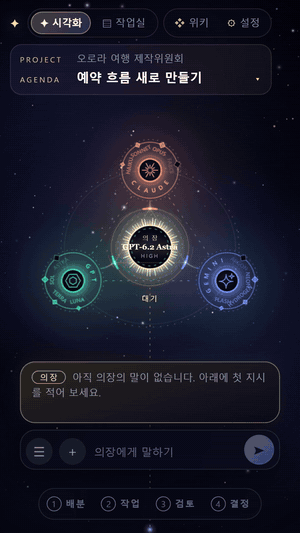 |
| **≡ テキスト** | 基本の作業室です。議題一覧、議長との会話、委員カード(ログ · diff · マージ · 停止 · 引き継ぎ)が一画面にあります。 |

## 主な機能

| | |
|---|---|
| **4つの会社、モデルのはしご** | Claude(haiku · sonnet · opus · fable)、GPT(luna · terra · sol · astra)、Gemini(flash · hydrogen · neon · argon)、Grok。ユーザーは会社ごとに**同時人数 · 最上位モデル · 最大推論レベル**だけを決め、議長がその範囲でタスクごとに選びます。 |
| **並列作業と安全なマージ** | 委員ごとに独立した worktree · ブランチを使います。マージは議長だけが行い、衝突したら元に戻して報告します。git リポジトリでないフォルダには、その場にローカル git を作って使います。 |
| **アカウント · 上限の管理** | 複数のアカウントに前もってログインしておくと、上限に達したアカウントは飛ばし、止まった委員は同じ worktree で別のアカウント · モデルが引き継ぎます(ハンドオーバー)。会社ごとの5時間 · 週間の残り使用量を表示します。 |
| **共有メモリ · Gen Wiki** | 委員と議長が学んだ解決策 · ツールの場所 · 規約を共有メモリに提案し、整理された内容は Wiki ページにまとまります。初回インストール時は、議長 · 委員の運用法、モデルごとの癖、CLI · git · Windows · ウェブの落とし穴をまとめた**91ページの基本 Wiki**から始まります。 |
| **ウェブ · モバイル** | ローカルサーバー1つでウェブUI(PWA)を提供します。Tailscale を使えば、スマートフォンでも同じ画面をホーム画面アプリのように使えます([スマートフォンで使う](#-スマートフォンで使う))。 |
| **リレー委員** | CLIのないウェブAI(ウェブ版 Gemini、AI Studio、ChatGPT ウェブ版)は、人がパケットをコピーして答えを貼り付ける方式で委員になります。 |
| **通知 · 常駐** | Telegram ボットで議長と会話し、決定の依頼や完了の通知を受け取ります。Windows のログオンタスクとして常駐させられます。 |

<div align="center">
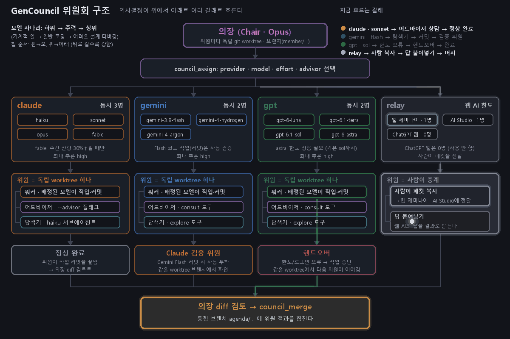
</div>

## 仕組み

```
プロジェクト(製作委員会) = 作業フォルダ1つ + 分担のガイドライン + 議長の設定
 └ 議題                  = 目標 + 統合ブランチ agenda/<議題>
    ├ タスク T1, T2 …    = 議長が分けた単位
    └ 委員               = タスクを1つ受け持ち、自分の worktree · ブランチで実行 → 結果を報告 → 議長がレビュー · マージ
```

1. ウェブでプロジェクトフォルダを選んで製作委員会を作り、新しい議題を開きます。
2. 議長にやりたいことを伝えます。議長が目標を整理し、タスクに分けます。
3. 議長がタスクごとに委員を送ります。簡単な仕事は下位モデル、普通のコーディングは主力モデル、難しい設計だけ上位モデルに回ります。
4. 委員が終わると、議長が diff を見てマージするかやり直させます。決定が必要なときは、選択肢を付けてユーザーに尋ねます。
5. 議題を閉じると、議長が振り返りを残し(共有メモリ · モデルの癖)、結果をベースブランチにマージします。

## はじめに

**必要なもの**

- Windows 10/11(主に Windows で開発・テストしています。macOS · Linux は未検証です)
- Node.js 22 以上、git
- [Claude Code](https://docs.anthropic.com/claude-code) CLI へのログイン(議長の既定)
- 任意: [Codex CLI](https://github.com/openai/codex)(GPT 委員)、Antigravity CLI(Gemini 委員、下の注意を参照)、Grok CLI、Chrome(ウェブAIリレー)

**インストール**

```bash
git clone https://github.com/GENGA9/GenCouncil.git
cd GenCouncil
npm install && npm run build
npm link --workspace @gencouncil/mcp     # グローバルな gencouncil コマンド
gencouncil init                          # 共有メモリのフォルダ (~/.gencouncil)
gencouncil install claude                # Claude Code に共有メモリ MCP を登録
```

**起動**

```bash
gencouncil web          # http://localhost:7700
gencouncil web token    # 初回アクセス時に入力するトークン
```

ブラウザで開いてトークンを入力すれば使えます。サーバーは既定でこのPCの中(127.0.0.1)だけで開き、ほかの端末は下のように Tailscale から入ります。専用ウィンドウとフローティング議長を使うには、[apps/desktop](apps/desktop/README.md) のデスクトップアプリをビルドしてください(Rust が必要)。

## 📱 スマートフォンで使う

AIは自宅のPCで働き続け、スマートフォンでは同じ画面を開いて指示を出し、結果を受け取ります。

1. PCとスマートフォンに [Tailscale](https://tailscale.com) をインストールし、同じアカウントでログインします(自分だけが入れるプライベートネットワーク)。
2. PCで一度だけ実行します。Tailscale が HTTPS 証明書まで付けてくれます。
   ```bash
   tailscale serve --bg 7700
   ```
3. スマートフォンのブラウザで `https://<PC名>.<tailnet>.ts.net` を開き、トークンを入力します(正確なアドレスは `gencouncil web` の起動時に表示されます)。
4. ブラウザメニューの**ホーム画面に追加**でインストールすると、独立したアプリのように開きます。

API · WebSocket はすべてトークンが必要で、サーバーを自宅の Wi-Fi やインターネットに直接公開しないため、Tailscale に入った自分の端末だけがアクセスできます。Telegram ボットからもつながります。議長の返答、委員の結果、選択ボタン付きの決定の質問が届き、ボットに書いた内容はその議題の議長に渡されます。設定は[ガイドの Telegram](docs/GUIDE.md#telegram)(韓国語)にあります。

## ⚠️ Gemini(Antigravity CLI)は既定でオフです

Google の [Antigravity 追加規約](https://antigravity.google/terms)第6条は、第三者のソフトウェアからサービスにアクセスすることを違反(アカウント停止 · 解約の理由)としており、[Antigravity FAQ](https://antigravity.google/docs/faq) は `agy` を第三者のコーディングエージェントやアプリに組み込んで使うことを、個人向けプランではサポートしないと書いています。GenCouncil は Gemini の委員 · 議長のために `agy` を自動で実行するので、**オフの間は `agy` を一度も実行しません。**

使うには、**アカウント**画面で「リスクを読んでオン」を押し、リスクの説明を読んだうえで、自分の判断でオンにするというチェックを入れてください。オンにする判断とその結果の責任はユーザーにあります。リスクなしで Gemini を使うには、オフのまま**リレー**(ウェブ版 Gemini · AI Studio)を使ってください。Claude Code · Codex CLI · Grok も、それぞれのサービスの規約と利用上限をご自身で確認してください。

## ドキュメント

- [ガイド](docs/GUIDE.md)(韓国語): 製作委員会 · 委員の自律性 · 上限 · アカウントとハンドオーバー · リレー · ウェブUI · 表示モード · Telegram · 常駐 · CLI · MCP ツール · ログ
- [設計ドキュメント](docs/ARCHITECTURE.md)(韓国語): 構造と設計判断の背景

## 開発

```bash
npm test                                   # 全テスト (LLM 呼び出しなし)
npm run dev --workspace @gencouncil/web    # ウェブUIの開発サーバー
```

サーバーなしで見るには、開発サーバーで `/vision-demo.html` を開きます。`?avatar` はアバターモード、`?meeting` は会議室、`?float=1` はフローティング議長、`?film`(`?avatar` と一緒に)は上の動画の場面、`?lang=en` や `?lang=ja` は言語です。`promo/record.mjs` は場面をフレーム単位で録画し、`promo/shots.mjs` はこの README のスクリーンショットを撮ります。

| パッケージ | 役割 |
|---|---|
| `packages/core` | 共有メモリ · Gen Wiki のストア(markdown + git)、検索、基本 Wiki |
| `packages/council` | プロジェクト · 議題 · アカウント、worktree、委員ドライバー、議長セッション、上限 · ハンドオーバー |
| `packages/server` | REST + WebSocket サーバー、静的UI、議長用 MCP、Telegram |
| `packages/mcp` | 共有メモリ MCP サーバー(stdio)と登録ツール |
| `packages/cli` | `gencouncil` コマンド |
| `apps/web` | React PWA(作業室 · ビジョン · アバター · 会議室、韓国語 · 英語 · 日本語) |
| `apps/desktop` | フローティング議長付きの Tauri 2 トレイアプリ |

## ライセンス

[MIT](LICENSE)
