<div align="center">

# ✦ GenCouncil

[English](README.md) · **한국어** · [日本語](README.ja.md)

**AI 팀이 내 책상 위 작은 서재에 사는 로컬 멀티 AI 오케스트레이터**

의장 AI가 일을 나눠 Claude · GPT · Gemini · Grok 위원에게 동시에 맡기고, 결과를 검토해 하나로 합칩니다. 아바타 모드에서는 그 과정이 그대로 보입니다. 의장은 책상에 앉아 있고, 위원들은 작은 캐릭터가 되어 책상 위에서 일하고, 말하고, 보고하고, 졸고, 춤춥니다.

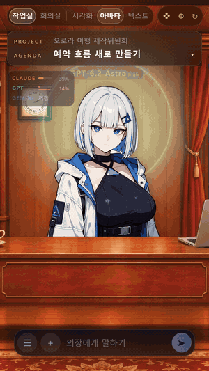

<sub>휴대폰에서 본 아바타 모드 · 의장을 GPT에서 Claude로 바꾸고, 지시 한 줄을 다섯 모델에게 나눠 맡긴 뒤 의장이 춤추는 장면 · 영상: <a href="docs/media/avatar/avatar-9x16-ko.mp4">휴대폰(mp4, 30초)</a> · <a href="docs/media/avatar/avatar-16x9-ko.mp4">데스크톱(mp4, 30초)</a></sub>

</div>

---

## 무엇인가요

GenCouncil은 내 PC에서 도는 **멀티 AI 오케스트레이터**입니다. AI 코딩 도구는 각자 잘하는 일이 다릅니다. 빠르고 싼 모델, 꼼꼼한 모델, 어려운 설계를 끝까지 풀어내는 모델이 따로 있습니다. GenCouncil은 이들을 **"제작위원회"** 로 묶고, 누가 무엇을 언제 맡을지 조율해 한 프로젝트에서 같이 일하게 합니다.

- **판단은 AI가**: 의장 모델이 일을 쪼개고, 작업마다 회사 · 모델 · 추론 수준을 고르고, 결과를 검토해 합칠지 다시 시킬지 정합니다.
- **실행 관리는 GenCouncil이**: 위원 프로세스 실행과 중지, worktree 격리, 사용자가 정한 한도 지키기, 계정 한도가 차면 이어받기, 진행 상황과 보고를 의장에게 전달하는 일은 서버가 맡습니다.

모든 AI는 **이미 쓰고 있는 구독 로그인 그대로** 헤드리스 CLI로 돌아갑니다(Claude Code, Codex CLI, Antigravity CLI, Grok). API 키 과금이 아니라 구독 한도 안에서 움직이고, 한도가 차면 다른 계정이나 낮은 모델로 이어서 일합니다.

## 🎭 아바타 모드

이제부터 GenCouncil의 주력 화면은 아바타 모드입니다. 작업실과 같은 위원회를, 들여다볼 수 있는 방으로 보여 줍니다.

<div align="center">
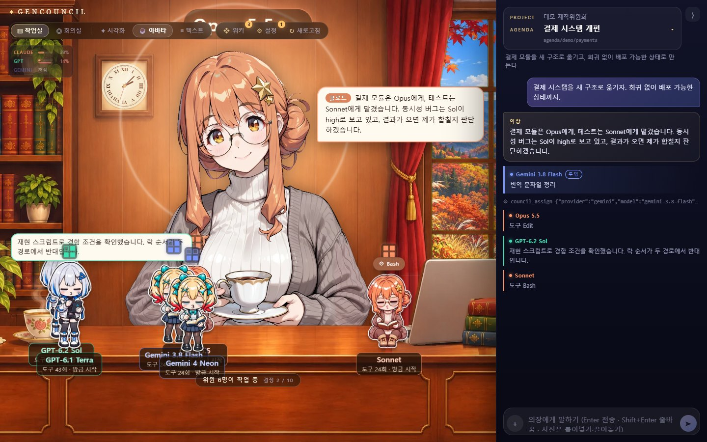
</div>

- **책상에 앉은 의장.** 의장은 자기 회사의 캐릭터로 나옵니다(Claude · GPT · Gemini · Grok, 웹 릴레이는 닷츠). 의장 모델을 바꾸면 다른 캐릭터가 자리에 앉습니다. 답은 말풍선으로 나오고, 목소리가 들리는 동안 입이 움직입니다.
- **책상 위의 위원.** 의장이 보낸 위원은 모델 이름과 진행 상황을 단 작은 캐릭터로 책상에 내려옵니다. 시작 · 완료 · 실패할 때 한마디씩 하고, 돌아다니거나 앉아서 일하다가, 끝나면 의장에게 보고하러 걸어갑니다.
- **자기들끼리의 잡담.** 일하는 동안 위원들은 가끔 혼잣말을 하거나 서로 짧게 대화합니다(한국어 · 일본어 · 영어로 쓴 대사 수백 개).
- **목소리.** 의장과 위원의 이벤트 대사는 녹음된 목소리로 나옵니다. 원하면 녹음이 없는 말(의장의 답, 잡담)도 TTS로 읽어 줍니다(녹음과는 다른 목소리).
- **옆에 펼친 기록.** 넓은 화면에서는 안건 기록(지시 · 답 · 위원 보고)이 오른쪽에 늘 열려 있습니다. 휴대폰에서는 입력창과 의장의 최근 말이 아래에 붙어 있습니다.

<table>
<tr>
<td width="50%">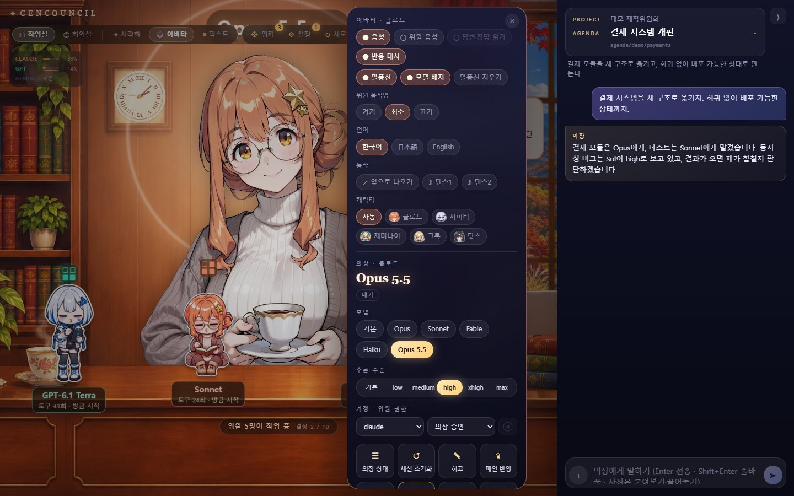</td>
<td width="50%">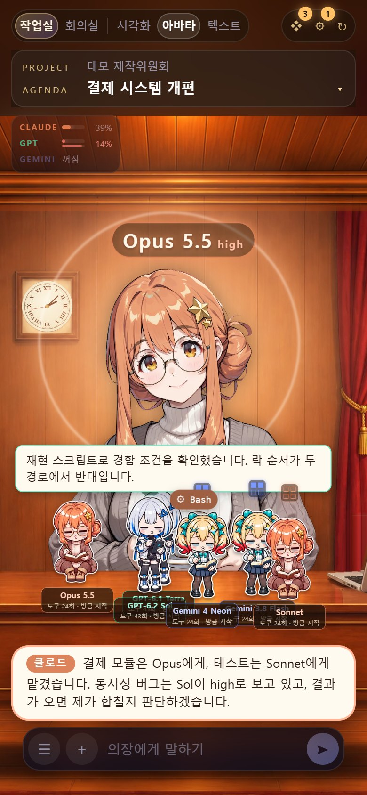</td>
</tr>
<tr>
<td><sub><b>의장 메뉴</b>(오른쪽 클릭, 휴대폰은 길게 누르기): 음성 켜고 끄기, 위원 음성, 답변 · 잡담 읽기, 반응 대사, 말풍선, 위원이 움직이는 정도, 언어, 캐릭터 고정, 앞으로 나오기와 춤. 아래에는 의장 모델 · 추론 수준 · 계정과 안건 동작이 있습니다.</sub></td>
<td><sub><b>휴대폰</b>: 좁은 화면에 맞춘 같은 서재. 입력창으로 지시하고, 손가락으로 위원을 집어 들 수 있습니다.</sub></td>
</tr>
</table>

### 장난 기능

<table>
<tr>
<td width="50%">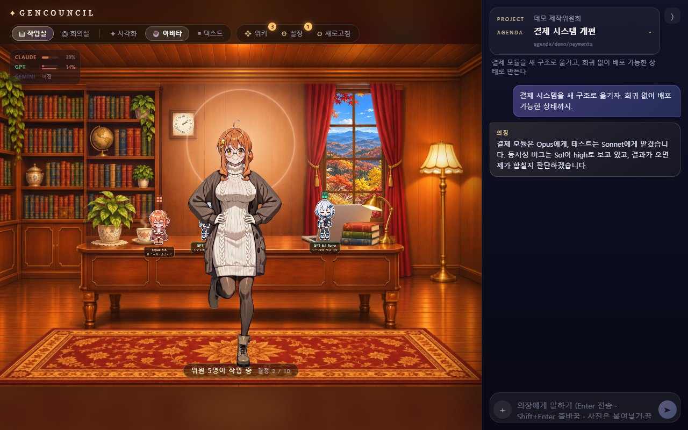</td>
<td width="50%">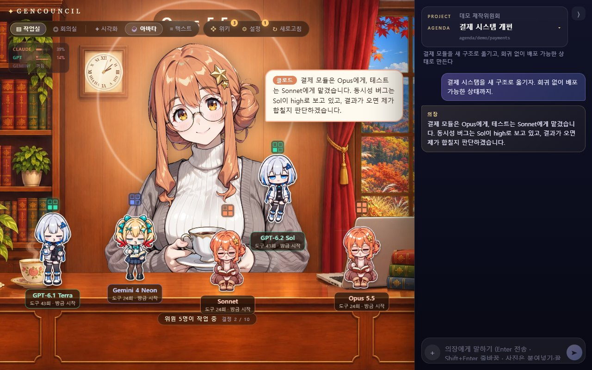</td>
</tr>
<tr>
<td><sub><b>앞으로 나와 춤추기</b>: 전신 그림이 있는 캐릭터는 자리에서 일어나 책상을 돌아 앞으로 나와 춤춥니다(캐릭터마다 춤 두 가지). 카메라가 물러나 머리부터 발끝까지 보여 줍니다.</sub></td>
<td><sub><b>위원 집어 들기</b>: 위원을 누른 채로(마우스나 손가락) 들어 옮기다 놓으면 책상에 떨어졌다가 툭 털고 일어납니다.</sub></td>
</tr>
</table>

- **의장을 누르면** 캐릭터다운 한마디와 함께 볼을 붉히며 살짝 튀어 오릅니다.
- 위원은 **넘어지고, 기다리는 동안 졸고, 끝나면 환호하고, 실패하면 풀이 죽습니다.**
- 서재 창밖은 **계절과 시간**을 따라 바뀝니다.

### 회의실

<div align="center">
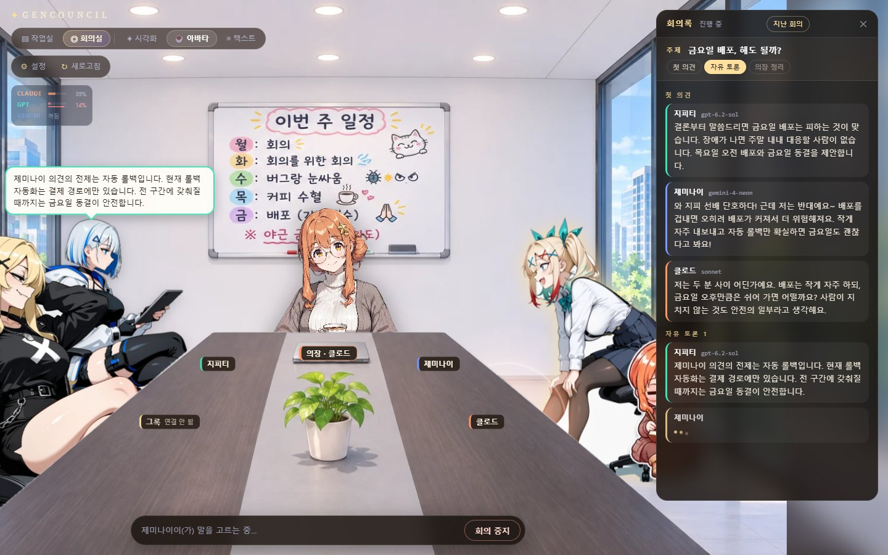
</div>

회의실에 주제를 던지면 위원들이 테이블에 둘러앉습니다. 각자 의견을 내고 토론한 뒤, 의장이 결론을 정리합니다. 회의록은 오른쪽에 남습니다. 작업실이 일을 처리하는 곳이라면, 회의실은 생각을 나누는 곳입니다.

### 플로팅 의장 (데스크톱 앱)

<div align="center">
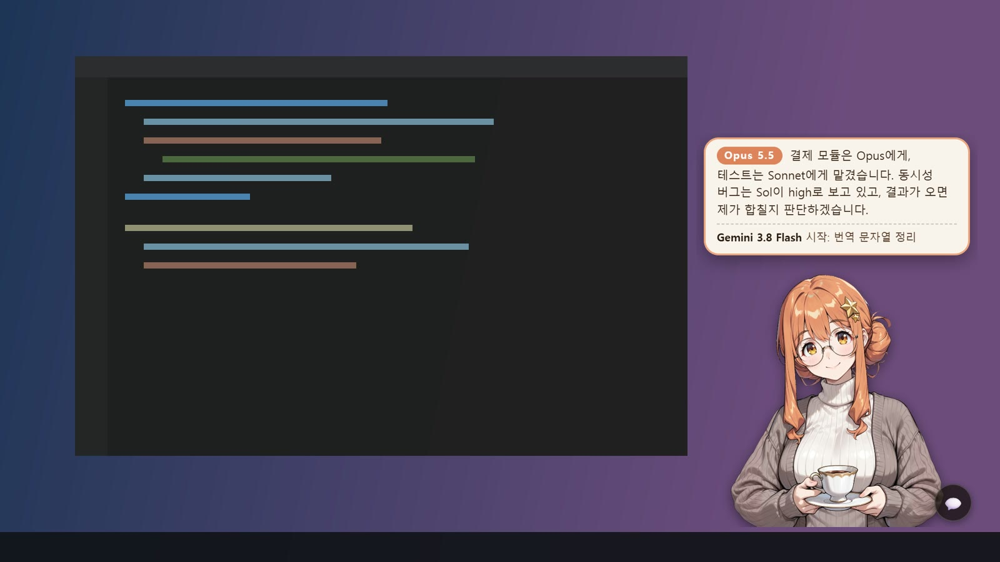
</div>

Windows 데스크톱 앱([apps/desktop](apps/desktop/README.md))에서 창을 닫아 트레이로 보내면 의장이 바탕화면에 남습니다. 오른쪽 아래의 작은 투명 창이고, 항상 위에 떠 있지만 포커스는 가져가지 않습니다. 말풍선에는 의장의 최근 답, 결정을 기다리는 질문, 최근 위원 보고가 나오고, 💬를 누르면 입력창이 열려 바로 지시할 수 있습니다. 끌어서 아무 데나 옮기고, 더블클릭하면 메인 창이 돌아옵니다.

### 단일 모드

<div align="center">
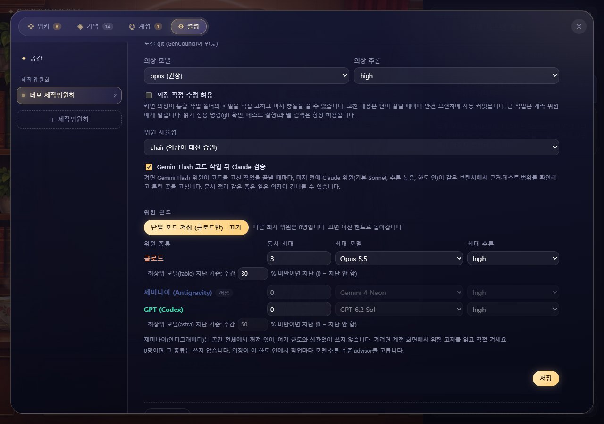
</div>

위원회 전체를 한 회사로만 돌리고 싶을 때, 위원회 설정의 버튼 하나로 **의장과 같은 회사** 위원만 남기고 다른 회사는 모두 0명으로 바꿉니다. 끄면 이전 한도로 돌아갑니다.

### 세 가지 언어

콘솔 전체와 캐릭터 대사 · 목소리를 **한국어 · 영어 · 일본어** 중에서 고릅니다. 텍스트 작업실의 테마 버튼 옆, 설정 › 공간 › 화면, 또는 의장 메뉴에서 바꿉니다. 서버 메시지와 의장 · 위원이 쓴 글은 그대로 둡니다.

## 다른 보기

같은 위원회를 세 가지로 볼 수 있습니다. 왼쪽 위 스위치로 보기를 바꾸고, 방(작업실 · 회의실)은 그대로 둡니다.

| | |
|---|---|
| **🎭 아바타** | 위의 서재입니다. |
| **✦ 시각화** | 의장을 가운데, 회사들을 꼭짓점에 둔 밤하늘 그림입니다. 지시가 선을 타고 내려가 원반이 모델을 고르고, 위원이 가지처럼 자라 일합니다. <br>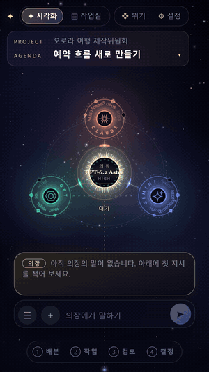 |
| **≡ 텍스트** | 기본 작업실입니다. 안건 목록, 의장 대화, 위원 카드(로그 · diff · 머지 · 중지 · 이어받기)가 한 화면에 있습니다. |

## 주요 기능

| | |
|---|---|
| **네 회사, 모델 사다리** | Claude(haiku · sonnet · opus · fable), GPT(luna · terra · sol · astra), Gemini(flash · hydrogen · neon · argon), Grok. 사용자는 회사별 **동시 인원 · 최대 모델 · 최대 추론 수준**만 정하고, 의장이 그 안에서 작업마다 고릅니다. |
| **병렬 작업과 안전한 합치기** | 위원마다 독립 worktree · 브랜치를 씁니다. 머지는 의장만 하고, 충돌이 나면 되돌리고 보고합니다. git 저장소가 아닌 폴더에는 로컬 git을 만들어 그대로 씁니다. |
| **계정 · 한도 관리** | 계정을 여러 개 미리 로그인해 두면 한도가 찬 계정을 건너뛰고, 멈춘 위원은 같은 worktree에서 다른 계정 · 모델이 이어받습니다(핸드오버). 회사별 5시간 · 주간 남은 사용량을 보여 줍니다. |
| **공유 기억 · Gen Wiki** | 위원과 의장이 알게 된 해결책 · 도구 위치 · 규약을 공유 기억에 제안하고, 정리된 내용은 위키 페이지로 모입니다. 처음 설치하면 의장 · 위원 운영법, 모델별 성향, CLI · git · Windows · 웹 함정을 담은 **기본 위키 91쪽**으로 시작합니다. |
| **웹 · 모바일** | 로컬 서버 하나에 웹 UI(PWA). Tailscale로 휴대폰에서도 같은 화면을 홈 화면 앱처럼 씁니다([휴대폰에서 쓰기](#-휴대폰에서-쓰기)). |
| **릴레이 위원** | CLI가 없는 웹 AI(웹 Gemini, AI Studio, ChatGPT 웹)는 사람이 패킷을 복사해 붙여넣는 방식으로 위원이 됩니다. |
| **알림 · 상주** | Telegram 봇으로 의장과 대화하고 결정 요청 · 완료 알림을 받습니다. Windows 로그온 작업으로 상주시킬 수 있습니다. |

<div align="center">
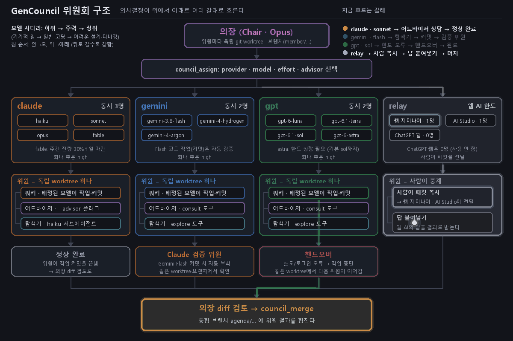
</div>

<div align="center">
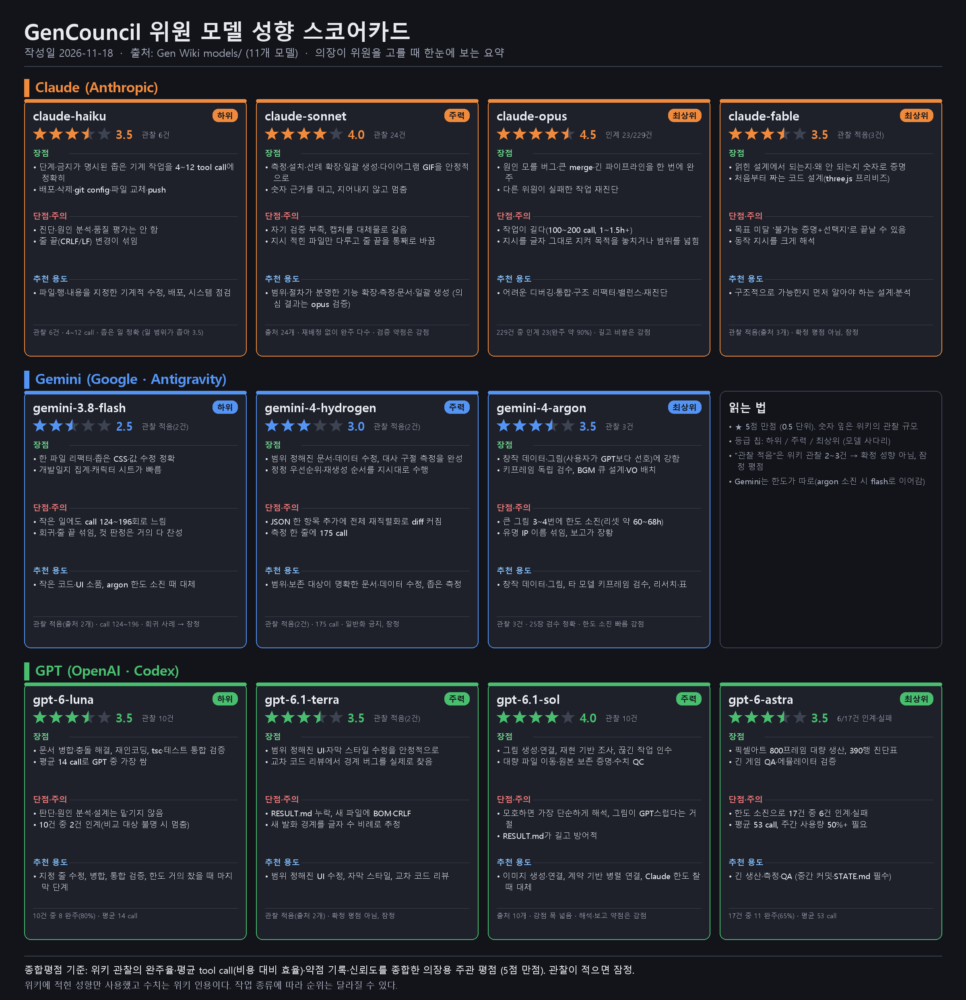
<br><sub>위원으로 써 본 관찰을 바탕으로 한 모델별 점수와 한 줄 성격(주관 평가). 의장은 이런 성향과 과거 기록을 보고 모델을 고릅니다.</sub>
</div>

## 이렇게 동작합니다

```
프로젝트(제작위원회) = 작업 폴더 1개 + 업무 분장 가이드라인 + 의장 설정
 └ 안건              = 목표 + 통합 브랜치 agenda/<안건>
    ├ 작업 T1, T2 …  = 의장이 쪼갠 단위
    └ 위원           = 작업 하나를 맡아 자기 worktree · 브랜치에서 실행 → 결과 보고 → 의장이 검토 · 합치기
```

1. 웹에서 프로젝트 폴더를 골라 제작위원회를 만들고, 새 안건을 엽니다.
2. 의장에게 하고 싶은 일을 말합니다. 의장이 목표를 정리하고 작업을 쪼갭니다.
3. 의장이 작업마다 위원을 보냅니다. 쉬운 일은 하위 모델, 일반 코딩은 주력 모델, 어려운 설계만 상위 모델에게 갑니다.
4. 위원이 끝나면 의장이 diff를 보고 합치거나 다시 시킵니다. 결정이 필요하면 선택지와 함께 사용자에게 묻습니다.
5. 안건을 닫으면 의장이 회고를 남기고(공유 기억 · 모델 성향), 결과를 베이스 브랜치에 합칩니다.

## 시작하기

**필요한 것**

- Windows 10/11 (주로 Windows에서 개발하고 시험했습니다. macOS · Linux는 시험하지 않았습니다)
- Node.js 22 이상, git
- [Claude Code](https://docs.anthropic.com/claude-code) CLI 로그인 (의장 기본값)
- 선택: [Codex CLI](https://github.com/openai/codex) 로그인(GPT 위원), Antigravity CLI(Gemini 위원, 아래 주의 참고), Grok CLI, Chrome(웹 AI 릴레이)

**설치**

```bash
git clone https://github.com/GENGA9/GenCouncil.git
cd GenCouncil
npm install && npm run build
npm link --workspace @gencouncil/mcp     # 전역 gencouncil 명령
gencouncil init                          # 공유 기억 폴더 (~/.gencouncil)
gencouncil install claude                # Claude Code에 공유 기억 MCP 등록
```

**실행**

```bash
gencouncil web          # http://localhost:7700
gencouncil web token    # 처음 접속할 때 넣을 토큰
```

브라우저에서 열고 토큰을 넣으면 됩니다. 서버는 기본으로 이 PC 안(127.0.0.1)에서만 열리고, 다른 기기는 아래처럼 Tailscale로 들어옵니다. 자기 창과 플로팅 의장을 쓰려면 [apps/desktop](apps/desktop/README.md)의 데스크톱 앱을 빌드하세요(Rust 필요).

## 📱 휴대폰에서 쓰기

AI들은 집 PC에서 계속 일하고, 휴대폰으로는 같은 화면을 열어 지시하고 결과를 받습니다.

1. PC와 휴대폰에 [Tailscale](https://tailscale.com)을 설치하고 같은 계정으로 로그인합니다(나만 접속할 수 있는 사설망).
2. PC에서 한 번만 실행합니다. Tailscale이 HTTPS 인증서까지 붙여 줍니다.
   ```bash
   tailscale serve --bg 7700
   ```
3. 휴대폰 브라우저에서 `https://<PC 이름>.<tailnet>.ts.net`을 열고 토큰을 넣습니다(`gencouncil web`을 띄울 때 정확한 주소가 출력됩니다).
4. 브라우저 메뉴의 **홈 화면에 추가**로 설치하면 독립 앱처럼 열립니다.

API · WebSocket은 모두 토큰이 있어야 하고, 서버를 집 Wi-Fi나 인터넷에 직접 열지 않으므로 Tailscale에 들어온 내 기기만 접속할 수 있습니다. Telegram 봇으로도 이어집니다. 의장의 답, 위원 결과, 선택 버튼이 달린 결정 질문이 오고, 봇에게 쓴 글은 그 안건의 의장에게 전달됩니다. 설정은 [상세 안내의 Telegram](docs/GUIDE.md#telegram)에 있습니다.

## ⚠️ Gemini(Antigravity CLI)는 기본으로 꺼져 있습니다

Google [Antigravity 추가 약관](https://antigravity.google/terms) 6조는 제3자 소프트웨어로 서비스에 접근하는 것을 위반(계정 정지 · 해지 사유)으로 보고, [Antigravity FAQ](https://antigravity.google/docs/faq)는 `agy`를 제3자 코딩 에이전트 · 앱 안에 감싸 쓰는 것을 개인 요금제에서 지원하지 않는다고 적고 있습니다. GenCouncil은 Gemini 위원 · 의장에 `agy`를 자동으로 실행하므로, **꺼져 있는 동안은 `agy`를 한 번도 실행하지 않습니다.**

쓰려면 **계정** 화면에서 "위험 읽고 켜기"를 누르고, 위험 고지를 읽은 뒤 "제 판단으로 켭니다"에 체크해야 합니다. 켜는 판단과 그에 따른 책임은 사용자에게 있습니다. 위험 없이 Gemini를 쓰려면 꺼 둔 채 **릴레이**(웹 Gemini · AI Studio)를 쓰세요. Claude Code · Codex CLI · Grok 쪽도 각 서비스의 약관과 사용 한도를 직접 확인하고 쓰세요.

## 문서

- [상세 안내](docs/GUIDE.md): 제작위원회 · 위원 자율성 · 한도 · 계정과 핸드오버 · 릴레이 · 웹 UI · 보기 모드 · Telegram · 상주 · CLI · MCP 도구 · 로그
- [설계 문서](docs/ARCHITECTURE.md): 구조와 설계 결정의 배경

## 개발

```bash
npm test                                   # 전체 테스트 (LLM 호출 없음)
npm run dev --workspace @gencouncil/web    # 웹 UI 개발 서버
```

서버 없이 보려면 개발 서버에서 `/vision-demo.html`을 엽니다. `?avatar`는 아바타 모드, `?meeting`은 회의실, `?float=1`은 플로팅 의장, `?film`(`?avatar`와 함께)은 위 영상의 장면, `?lang=en`이나 `?lang=ja`는 언어입니다. `promo/record.mjs`는 장면을 프레임 단위로 녹화하고, `promo/shots.mjs`는 이 README의 스크린샷을 찍습니다.

| 패키지 | 역할 |
|---|---|
| `packages/core` | 공유 기억 · Gen Wiki 저장소(markdown + git), 검색, 기본 위키 |
| `packages/council` | 프로젝트 · 안건 · 계정, worktree, 위원 드라이버, 의장 세션, 한도 · 핸드오버 |
| `packages/server` | REST + WebSocket 서버, 정적 UI, 의장용 MCP, Telegram |
| `packages/mcp` | 공유 기억 MCP 서버(stdio)와 등록기 |
| `packages/cli` | `gencouncil` 명령 |
| `apps/web` | React PWA (작업실 · 시각화 · 아바타 · 회의실, 한국어 · 영어 · 일본어) |
| `apps/desktop` | 플로팅 의장이 있는 Tauri 2 트레이 앱 |

## 라이선스

[MIT](LICENSE)
