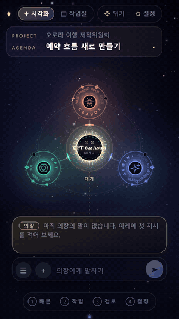
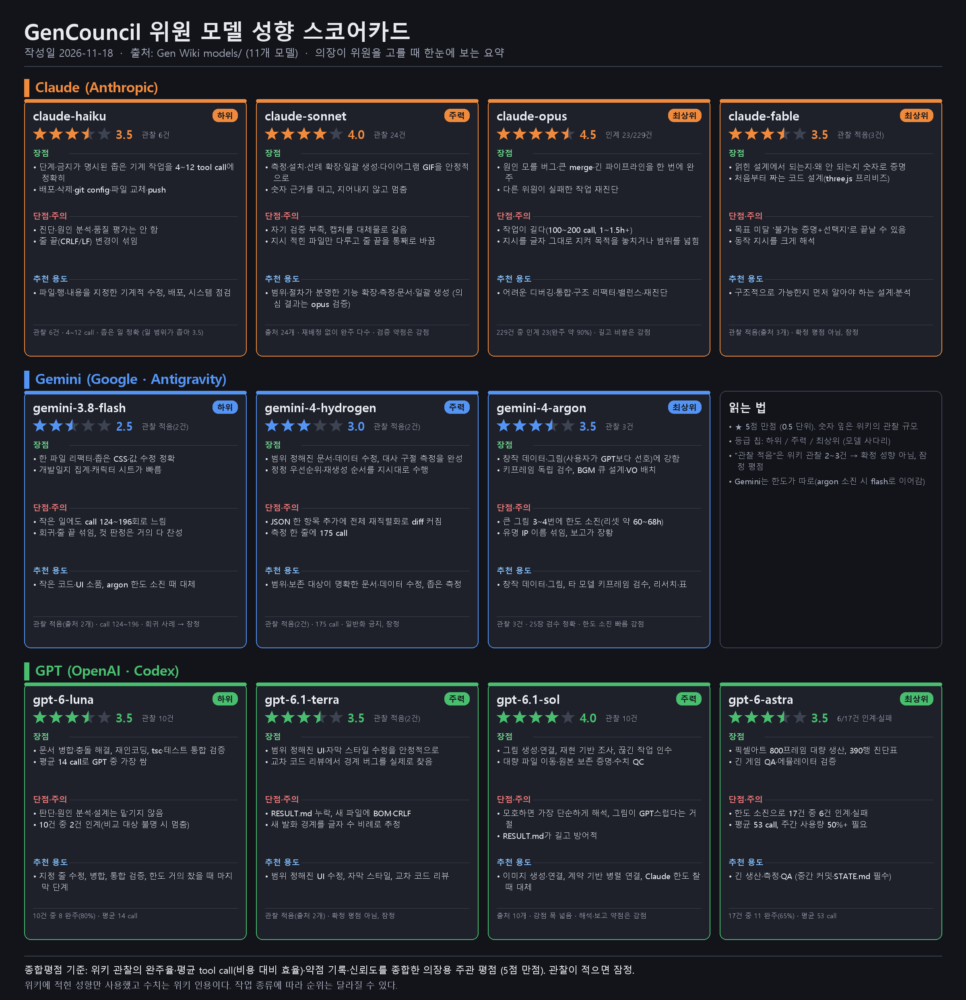

<div align="center">

# ✦ GenCouncil

**Claude · GPT · Gemini를 한 팀으로 묶는 로컬 멀티 AI 오케스트레이터**

의장 AI가 일을 나눠 각 회사의 알맞은 모델에게 동시에 맡기고, 결과를 검토해 하나로 합칩니다.<br>
A local multi-AI orchestrator: a chair model splits the work across Claude, GPT and Gemini members, runs them in parallel and merges what they deliver.



<sub>휴대폰에서 본 시각화 모드 · 의장을 GPT-6.2 Astra에서 Opus 5.5로 바꾸고, 지시 한 줄을 다섯 모델에게 나눠 맡기는 장면 · <a href="docs/media/gencouncil-mobile.mp4">고화질 영상(mp4, 15초)</a></sub>

</div>

---

## 무엇인가요

GenCouncil은 내 PC에서 도는 **멀티 AI 오케스트레이터**입니다. AI 코딩 도구는 각자 잘하는 일이 다릅니다. 빠르고 싼 모델, 꼼꼼한 모델, 어려운 설계를 끝까지 풀어내는 모델이 따로 있습니다. GenCouncil은 이들을 **"제작위원회"** 로 묶고, 누가 무엇을 언제 맡을지 조율해 한 프로젝트에서 같이 일하게 합니다.

오케스트레이션은 두 층으로 나뉩니다.

- **판단은 AI가**: 의장 모델이 일을 쪼개고, 작업마다 회사 · 모델 · 추론 수준을 고르고, 결과를 검토해 합칠지 다시 시킬지 정합니다.
- **실행 관리는 GenCouncil이**: 위원 프로세스 실행과 중지, worktree 격리, 사용자가 정한 한도 지키기, 계정 · 한도 소진 시 이어받기, 진행 상황과 보고를 의장에게 전달하는 일은 서버가 맡습니다.

- **의장(Chair)** 은 사용자와 대화하며 목표를 정하고, 일을 작업 단위로 쪼개, 작업마다 가장 알맞은 회사·모델·추론 수준을 골라 **위원(Member)** 에게 맡깁니다.
- **위원** 은 각자 독립된 git worktree와 브랜치에서 일하고, 끝나면 결과를 보고합니다. 여러 위원이 동시에 일해도 서로의 파일을 건드리지 않습니다.
- 의장은 결과의 diff를 검토해 안건 브랜치에 합치고, 마지막에 사용자가 정한 베이스 브랜치에 반영합니다.

모든 AI는 **이미 쓰고 있는 구독 로그인 그대로** 헤드리스 CLI로 돌아갑니다(Claude Code, Codex CLI, Antigravity CLI). API 키 과금이 아니라 구독 한도 안에서 움직이고, 한도가 차면 다른 계정이나 낮은 모델로 이어서 일합니다.

<div align="center">

</div>

## 주요 기능

| | |
|---|---|
| **세 회사, 모델 사다리** | Claude(haiku · sonnet · opus · fable), GPT(luna · terra · sol · astra), Gemini(flash · hydrogen · neon · argon). 사용자는 회사별 **동시 인원 · 최대 모델 · 최대 추론 수준**만 정하고, 의장이 그 안에서 작업마다 고릅니다. |
| **병렬 작업과 안전한 합치기** | 위원마다 독립 worktree · 브랜치. 머지는 의장만 하고, 충돌이 나면 되돌리고 보고합니다. git 저장소가 아닌 폴더도 로컬 git을 만들어 그대로 씁니다. |
| **계정 · 한도 관리** | 계정을 여러 개 미리 로그인해 두면 한도가 찬 계정을 건너뛰고, 멈춘 위원은 같은 worktree에서 다른 계정·모델이 이어받습니다(핸드오버). 회사별 5시간 · 주간 남은 사용량을 보여 줍니다. |
| **공유 기억 · Gen Wiki** | 위원과 의장이 알게 된 해결책 · 도구 위치 · 규약을 공유 기억에 제안하고, 정리된 내용은 위키 페이지로 모입니다. 처음 설치하면 의장 · 위원 운영법, 모델별 성향, CLI · git · Windows · 웹 함정을 담은 **기본 위키 91쪽**으로 시작합니다. |
| **웹 · 모바일** | 로컬 서버 하나에 웹 UI(PWA). 작업실 화면(안건 · 의장 대화 · 위원 카드)과 **시각화 모드**(위 영상)를 오갈 수 있고, Tailscale로 휴대폰에서도 같은 화면을 씁니다. |
| **시각화 모드** | 의장을 가운데, 세 회사를 꼭짓점에 둔 밤하늘 그림. 지시가 선을 타고 내려가 원반이 모델을 고르고, 위원이 가지처럼 자라 일하고, 보고가 돌아옵니다. 의장 · 회사 · 위원을 누르면 같은 기능을 카드로 씁니다. |
| **릴레이 위원** | CLI가 없는 웹 AI(웹 Gemini, AI Studio, ChatGPT 웹)는 사람이 패킷을 복사해 붙여넣는 방식으로 위원이 됩니다. |
| **알림 · 상주** | Telegram 봇으로 의장과 대화하고 결정 요청 · 완료 알림을 받습니다. Windows 로그온 작업으로 상주시킬 수 있습니다. |

<div align="center">

<br><sub>위원으로 써 본 관찰을 바탕으로 한 모델별 점수와 한 줄 성격(주관 평가). 의장은 이런 성향과 과거 기록을 보고 모델을 고릅니다.</sub>
</div>

## 이렇게 동작합니다

```
프로젝트(제작위원회) = 작업 폴더 1개 + 업무 분장 가이드라인 + 의장 설정
 └ 안건              = 목표 + 통합 브랜치 agenda/<안건>
    ├ 작업 T1, T2 …  = 의장이 쪼갠 단위
    └ 위원           = 작업 하나를 맡아 자기 worktree · 브랜치에서 실행 → 결과 보고 → 의장이 검토 · 합치기
```

1. 웹에서 프로젝트 폴더를 골라 제작위원회를 만들고, 새 안건을 엽니다.
2. 의장에게 하고 싶은 일을 말합니다. 의장이 목표를 정리하고 작업을 쪼갭니다.
3. 의장이 작업마다 위원을 보냅니다. 쉬운 일은 하위 모델, 일반 코딩은 주력 모델, 어려운 설계만 상위 모델에게 갑니다.
4. 위원이 끝나면 의장이 diff를 보고 합치거나 다시 시킵니다. 결정이 필요하면 선택지와 함께 사용자에게 묻습니다.
5. 안건을 닫으면 의장이 회고를 남기고(공유 기억 · 모델 성향), 결과를 베이스 브랜치에 합칩니다.

## 시작하기

**필요한 것**

- Windows 10/11 (주로 Windows에서 개발하고 시험했습니다. macOS · Linux는 시험하지 않았습니다)
- Node.js 22 이상, git
- [Claude Code](https://docs.anthropic.com/claude-code) CLI 로그인 (의장 기본값)
- 선택: [Codex CLI](https://github.com/openai/codex) 로그인(GPT 위원), Antigravity CLI(Gemini 위원, 아래 주의 참고), Chrome(웹 AI 릴레이)

**설치**

```bash
git clone https://github.com/GENGA9/GenCouncil.git
cd GenCouncil
npm install && npm run build
npm link --workspace @gencouncil/mcp     # 전역 gencouncil 명령
gencouncil init                          # 공유 기억 폴더 (~/.gencouncil)
gencouncil install claude                # Claude Code에 공유 기억 MCP 등록
```

**실행**

```bash
gencouncil web          # http://localhost:7700
gencouncil web token    # 처음 접속할 때 넣을 토큰
```

브라우저에서 열고 토큰을 넣으면 됩니다. 왼쪽 위 `✦ 시각화 | ▤ 작업실` 스위치로 화면을 바꿉니다. 휴대폰에서 쓰려면 PC와 휴대폰을 같은 Tailscale에 넣고 `tailscale serve`로 열면 됩니다(자세한 순서는 상세 안내).

## ⚠️ Gemini(Antigravity CLI)는 기본으로 꺼져 있습니다

Google [Antigravity 추가 약관](https://antigravity.google/terms) 6조는 제3자 소프트웨어로 서비스에 접근하는 것을 위반(계정 정지 · 해지 사유)으로 보고, [Antigravity FAQ](https://antigravity.google/docs/faq)는 `agy`를 제3자 코딩 에이전트 · 앱 안에 감싸 쓰는 것을 개인 요금제에서 지원하지 않는다고 적고 있습니다. GenCouncil은 Gemini 위원 · 의장에 `agy`를 자동으로 실행하므로, **꺼져 있는 동안은 `agy`를 한 번도 실행하지 않습니다.**

쓰려면 **계정** 화면에서 "위험 읽고 켜기"를 누르고, 위험 고지를 읽은 뒤 "제 판단으로 켭니다"에 체크해야 합니다. 켜는 판단과 그에 따른 책임은 사용자에게 있습니다. 위험 없이 Gemini를 쓰려면 꺼 둔 채 **릴레이**(웹 Gemini · AI Studio)를 쓰세요. Claude Code와 Codex CLI 쪽도 각 서비스의 약관과 사용 한도를 직접 확인하고 쓰세요.

## 문서

- [상세 안내](docs/GUIDE.md): 제작위원회 · 위원 자율성 · 한도 · 계정과 핸드오버 · 릴레이 · 웹 UI · 시각화 모드 · Telegram · 상주 · CLI · MCP 도구 · 로그
- [설계 문서](docs/ARCHITECTURE.md): 구조와 설계 결정의 배경

## 개발

```bash
npm test                                   # 전체 테스트 (LLM 호출 없음)
npm run dev --workspace @gencouncil/web    # 웹 UI 개발 서버
```

서버 없이 시각화 모드를 보려면 개발 서버에서 `/vision-demo.html`을 엽니다(`?film`은 위 영상의 장면).

| 패키지 | 역할 |
|---|---|
| `packages/core` | 공유 기억 · Gen Wiki 저장소(markdown + git), 검색, 기본 위키 |
| `packages/council` | 프로젝트 · 안건 · 계정, worktree, 위원 드라이버, 의장 세션, 한도 · 핸드오버 |
| `packages/server` | REST + WebSocket 서버, 정적 UI, 의장용 MCP, Telegram |
| `packages/mcp` | 공유 기억 MCP 서버(stdio)와 등록기 |
| `packages/cli` | `gencouncil` 명령 |
| `apps/web` | React PWA (작업실 · 시각화 모드) |

## 라이선스

[MIT](LICENSE)
