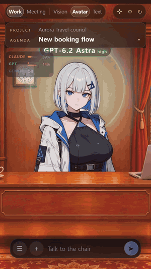
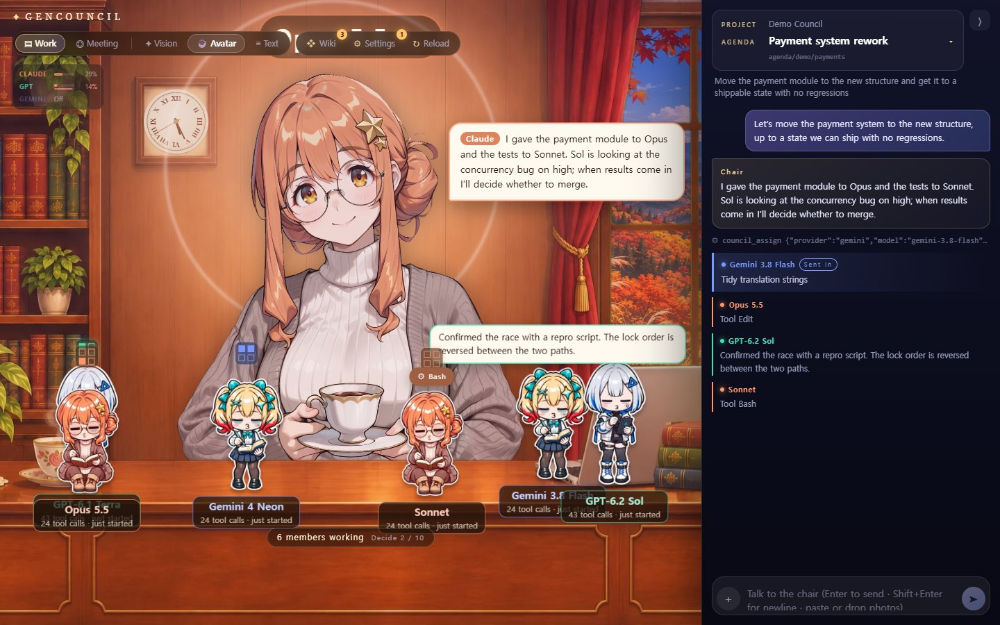
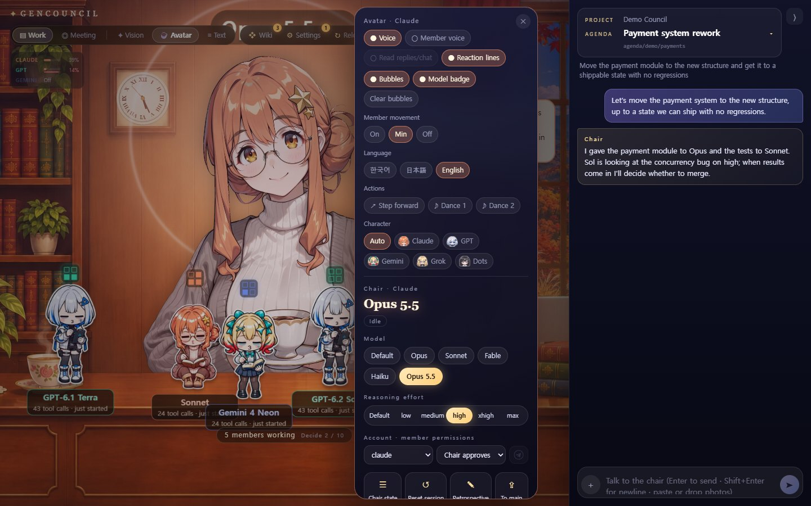
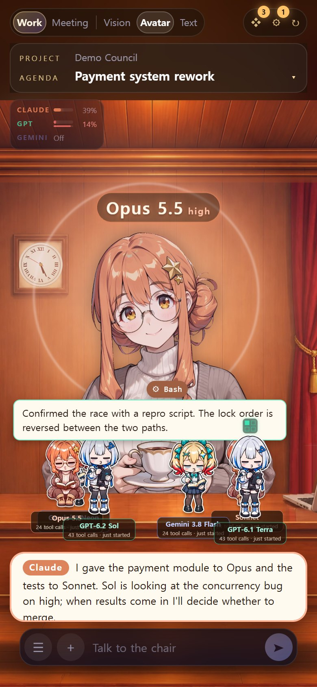
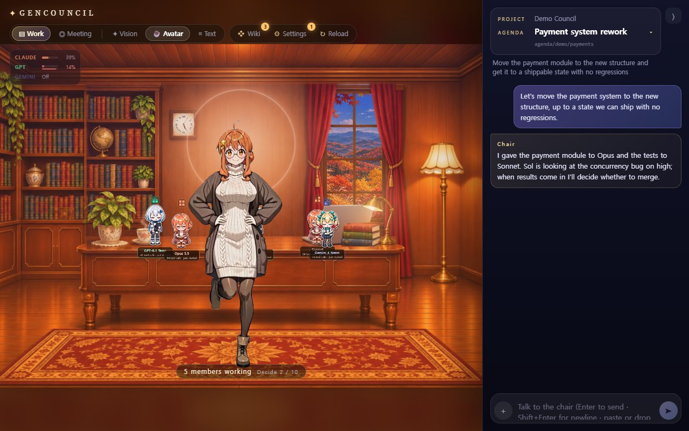
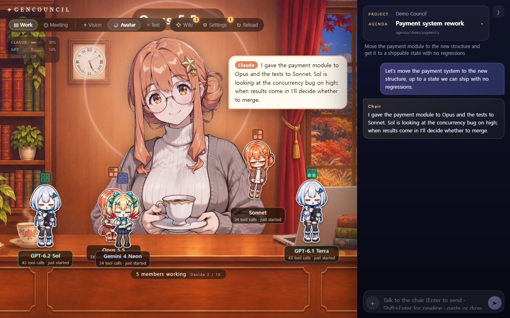
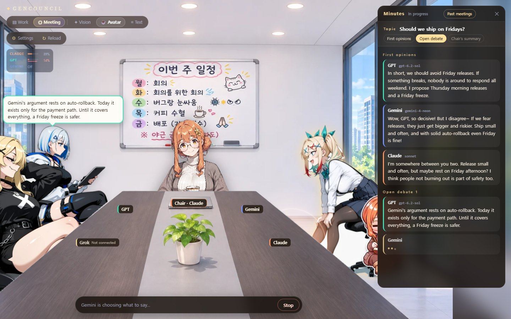
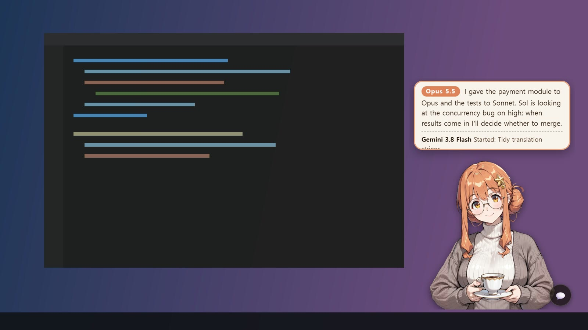
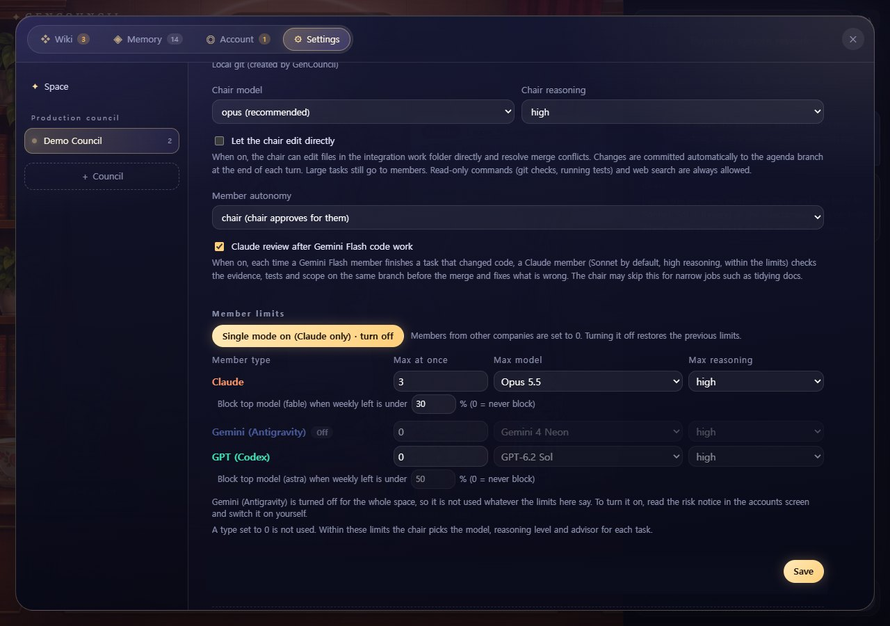
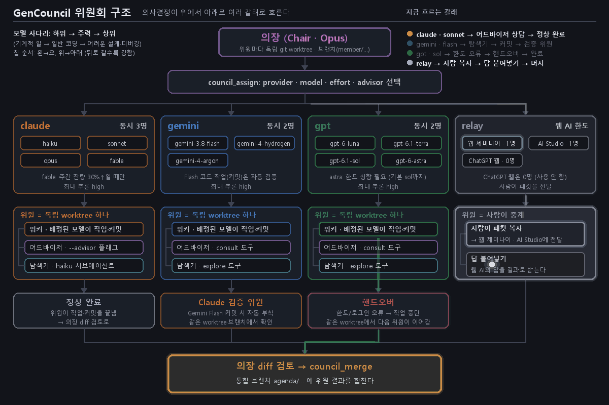

<div align="center">

# ✦ GenCouncil

**English** · [한국어](README.ko.md) · [日本語](README.ja.md)

**A local multi-AI orchestrator where your AI team lives in a little study on your desk.**

A chair model splits the work across Claude, GPT, Gemini and Grok members, runs them in parallel and merges what they deliver. In the avatar look you watch it happen: the chair sits at the desk, the members work on it as small characters, and they talk, report, nap and dance.



<sub>The avatar look on a phone · the chair changes from GPT to Claude, one order goes out to five models, and the chair dances when the work is under way · videos: <a href="docs/media/avatar/avatar-9x16-en.mp4">phone (mp4, 30 s)</a> · <a href="docs/media/avatar/avatar-16x9-en.mp4">desktop (mp4, 30 s)</a></sub>

</div>

---

## What it is

GenCouncil runs on your own PC and turns several AI coding tools into one team, a **"production council"**. Each tool is good at something different: some are fast and cheap, some are careful, some can carry a hard design through to the end. GenCouncil decides who does what and when, inside one project.

- **The AI decides**: the chair model breaks the work into tasks, picks a company, model and reasoning effort for each, reviews the results and decides whether to merge them or send them back.
- **GenCouncil runs it**: starting and stopping member processes, isolating each in its own git worktree, keeping to the limits you set, handing work over when an account runs out, and carrying progress and reports back to the chair.

Every AI runs as a headless CLI on **the subscription login you already have** (Claude Code, Codex CLI, Antigravity CLI, Grok). It works inside your plan's limits rather than on API billing, and when one limit is used up the work moves on to another account or a lower model.

## 🎭 Avatar look

The avatar look is GenCouncil's main screen from now on. It shows the same council as the workshop, as a room you can look into.

<div align="center">

</div>

- **The chair at the desk.** The chair appears as its company's character: Claude, GPT, Gemini or Grok, plus Dots for the web relays. Change the chair's model and a different character sits down. Its answers appear in a speech bubble, and its mouth moves while its voice is heard.
- **The members on the desk.** Each member the chair sends out lands on the desk as a small character with its model's name and progress. Members say a line when they start, finish or fail, wander about or keep working, and walk over to the chair to report.
- **They talk among themselves.** While they work, members sometimes say a line to themselves or hold a short conversation with each other (hundreds of scripted lines in Korean, Japanese and English).
- **Voices.** The chair's and members' event lines are recorded voices. Optionally, words nobody recorded (the chair's answers, the chatter) can be read aloud by TTS (a different voice).
- **The record beside it.** On a wide screen, the agenda's record (orders, answers, members' reports) stays open on the right. On a phone, the input box and the chair's latest words sit at the bottom.

<table>
<tr>
<td width="50%"></td>
<td width="50%"></td>
</tr>
<tr>
<td><sub><b>The chair's menu</b> (right click, or a long press on a phone): voice on or off, member voices, reading replies aloud, reaction lines, bubbles, how much the members move, the language, a fixed character, walking out and dancing. Below it are the chair's model, reasoning effort, account and the agenda's actions.</sub></td>
<td><sub><b>On a phone</b>: the same study fitted to a narrow screen. You can give orders from the input box and pick up members with your finger.</sub></td>
</tr>
</table>

### Playful bits

<table>
<tr>
<td width="50%"></td>
<td width="50%"></td>
</tr>
<tr>
<td><sub><b>Walk out and dance</b>: characters with a full-body rig stand up, walk round the desk, step out in front of it and dance (two dances each). The camera pulls back to show them head to toe.</sub></td>
<td><sub><b>Pick a member up</b>: hold a member (mouse or finger), carry it about and let go. It drops back onto the desk and picks itself up.</sub></td>
</tr>
</table>

- **Poke the chair** and it reacts with a line in character, a blush and a little bounce.
- Members **trip, nap while waiting, cheer when they finish and slump when they fail.**
- The study follows **the season and the time of day** outside its window.

### Meeting room

<div align="center">

</div>

Ask a question in the meeting room and the members sit round a table. Each gives an opinion, they argue it out, and the chair sums up a conclusion. The minutes stay on the right. The meeting room is for questions to talk through, while the workshop is for work that gets done.

### Floating chair (desktop app)

<div align="center">

</div>

With the Windows desktop app ([apps/desktop](apps/desktop/README.md)), closing the window into the tray leaves the chair on your desktop. It is a small transparent, always-on-top window at the bottom right that does not take the focus. Its bubble shows the chair's latest answer, a question it is waiting on, or the latest member report, and 💬 opens an input box for an order. Drag it anywhere. Double-click it to bring the main window back.

### Single mode

<div align="center">

</div>

When you want the whole council on one company, one button in the council's settings keeps only the members of **the chair's own company** and sets every other company to 0. Turning it off gives the earlier limits back.

### Three languages

The whole console, plus the characters' lines and voices, is in **Korean, English or Japanese**. Pick the language next to the theme button in the text workshop, in Settings › Space › Display, or in the chair's menu. Server messages and what the chair and members write stay as they are.

## Other looks

The same council can be seen three ways. The switch at the top left changes the look, and the room (workshop or meeting room) stays the same.

| | |
|---|---|
| **🎭 Avatar** | The study above. |
| **✦ Vision** | A night sky with the chair in the middle and the companies at the corners. An order runs down a line, a dial picks the model, and members grow like branches as they work. <br> |
| **≡ Text** | The plain workshop: agenda list, chat with the chair, and member cards with logs, diffs, merge, stop and handover. |

## Features

| | |
|---|---|
| **Four companies, model ladders** | Claude (haiku · sonnet · opus · fable), GPT (luna · terra · sol · astra), Gemini (flash · hydrogen · neon · argon), Grok. You set only **how many at once, the top model and the top effort** for each company. The chair picks within that for every task. |
| **Parallel work, safe merges** | Each member gets its own worktree and branch. Only the chair merges, and it backs out and reports on a conflict. A folder that is not a git repository gets a local git in place. |
| **Accounts and limits** | Log in to several accounts ahead of time. A full account is skipped, and a stopped member is taken over in the same worktree by another account or model (handover). The 5-hour and weekly usage left for each company is shown. |
| **Shared memory · Gen Wiki** | Members and the chair propose solutions, tool locations and conventions they learn to a shared memory, and what is settled becomes wiki pages. A fresh install starts with **a 91-page default wiki** on running the chair and members, each model's habits, and CLI, git, Windows and web pitfalls. |
| **Web · mobile** | One local server with a web UI (PWA). Through Tailscale, your phone gets the same screens as a home-screen app ([On your phone](#-on-your-phone)). |
| **Relay members** | Web AIs without a CLI (web Gemini, AI Studio, ChatGPT on the web) can be members: you copy a packet over and paste the answer back. |
| **Notifications · always on** | Talk to the chair and get decision requests and completion notices through a Telegram bot. It can run as a Windows logon task. |

<div align="center">

</div>

## How it works

```
Project (production council) = one work folder + guidelines for dividing the work + chair settings
 └ Agenda                    = goals + an integration branch agenda/<agenda>
    ├ Tasks T1, T2 …         = the units the chair breaks the work into
    └ Members                = each takes one task, runs in its own worktree and branch → reports → the chair reviews and merges
```

1. In the web UI, pick a project folder to make a council and open a new agenda.
2. Tell the chair what you want. It sets the goals and breaks the work down.
3. The chair sends a member for each task: easy jobs go to small models, ordinary coding to the main ones, and only hard design to the top ones.
4. When a member finishes, the chair reads the diff and merges it or sends it back. When it needs a decision, it asks you with options.
5. When the agenda closes, the chair writes a retrospective (shared memory, model habits) and merges the result into the base branch.

## Getting started

**You need**

- Windows 10/11 (developed and tested on Windows; macOS and Linux are untested)
- Node.js 22+, git
- A logged-in [Claude Code](https://docs.anthropic.com/claude-code) CLI (the default chair)
- Optional: [Codex CLI](https://github.com/openai/codex) (GPT members), Antigravity CLI (Gemini members, see the warning below), Grok CLI, Chrome (web AI relays)

**Install**

```bash
git clone https://github.com/GENGA9/GenCouncil.git
cd GenCouncil
npm install && npm run build
npm link --workspace @gencouncil/mcp     # the global gencouncil command
gencouncil init                          # the shared memory folder (~/.gencouncil)
gencouncil install claude                # register the shared memory MCP with Claude Code
```

**Run**

```bash
gencouncil web          # http://localhost:7700
gencouncil web token    # the token to enter the first time
```

Open it in a browser and enter the token. The server listens only on this PC (127.0.0.1) by default. Other devices come in through Tailscale, as below. For a window of its own with the floating chair, build the desktop app in [apps/desktop](apps/desktop/README.md) (needs Rust).

## 📱 On your phone

The AIs keep working on your PC at home while your phone opens the same screens to give orders and read results.

1. Install [Tailscale](https://tailscale.com) on the PC and the phone and log in with the same account (a private network only you can reach).
2. Run this once on the PC. Tailscale adds an HTTPS certificate.
   ```bash
   tailscale serve --bg 7700
   ```
3. On the phone, open `https://<PC name>.<tailnet>.ts.net` and enter the token (`gencouncil web` prints the exact address).
4. Use **Add to Home Screen** in the browser menu and it opens like an app.

Every API and WebSocket call needs the token, and the server is never opened to your Wi-Fi or the internet, so only your own devices on Tailscale can reach it. A Telegram bot is the other way in: the chair's answers, members' results and decision questions with buttons arrive there, and what you write goes to the agenda's chair. See [Telegram in the guide](docs/GUIDE.md#telegram).

## ⚠️ Gemini (Antigravity CLI) is off by default

Section 6 of Google's [Antigravity additional terms](https://antigravity.google/terms) treats reaching the service through third-party software as a breach (grounds for suspension or termination), and the [Antigravity FAQ](https://antigravity.google/docs/faq) says wrapping `agy` in a third-party coding agent or app is not supported on personal plans. GenCouncil runs `agy` automatically for Gemini members and chairs, so **while it is off, it never runs `agy` at all.**

To use it, press "Read risks, turn on" in **Accounts**, read the notice and tick the box saying you are turning it on by your own decision. The decision and its consequences are yours. To use Gemini without the risk, leave it off and use a **relay** (web Gemini, AI Studio). Check the terms and limits of Claude Code, Codex CLI and Grok yourself too.

## Docs

- [Guide](docs/GUIDE.md) (Korean): councils, member autonomy, limits, accounts and handover, relays, the web UI, the looks, Telegram, running as a service, CLI, MCP tools, logs
- [Architecture](docs/ARCHITECTURE.md) (Korean): the structure and why it is built that way

## Development

```bash
npm test                                   # all tests (no LLM calls)
npm run dev --workspace @gencouncil/web    # web UI dev server
```

Without a server, open `/vision-demo.html` on the dev server: `?avatar` for the avatar look, `?meeting` for the meeting room, `?float=1` for the floating chair, `?film` (with `?avatar`) for the scenes in the videos above, and `?lang=en` or `?lang=ja` for the language. `promo/record.mjs` records a film frame by frame, and `promo/shots.mjs` takes the screenshots in this README.

| Package | Role |
|---|---|
| `packages/core` | Shared memory and Gen Wiki store (markdown + git), search, default wiki |
| `packages/council` | Projects, agendas, accounts, worktrees, member drivers, chair sessions, limits, handover |
| `packages/server` | REST + WebSocket server, static UI, the chair's MCP, Telegram |
| `packages/mcp` | Shared memory MCP server (stdio) and installer |
| `packages/cli` | The `gencouncil` command |
| `apps/web` | React PWA (workshop, vision, avatar, meeting room; ko/en/ja) |
| `apps/desktop` | Tauri 2 tray app with the floating chair |

## License

[MIT](LICENSE)
